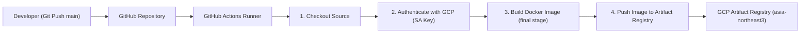

# GitHub Actions를 통한 GCP Artifact Registry 자동 빌드 및 배포 가이드

본 문서는 프로젝트 소스 코드를 컨테이너화하여 Google Cloud Platform(GCP) **Artifact Registry**에 자동으로 빌드 및 Push하는 CI/CD 파이프라인 구축 절차를 안내합니다.

---

## 1. 배포 대상 환경 정보

| 항목 | 값 | 설명 |
| :--- | :--- | :--- |
| **GCP Region** | `asia-northeast3` | 서울 리전 |
| **GCP Project ID** | `ssu-agent-vertex-509708` | 대상 GCP 프로젝트 |
| **Artifact Registry 저장소** | `suntaechung-repo` | Docker 레지스트리 저장소 |
| **이미지 명** | `todo-backend` | 생성될 컨테이너 이미지 이름 |
| **태그** | `prod` | 배포 태그 |
| **최종 이미지 URI** | `asia-northeast3-docker.pkg.dev/ssu-agent-vertex-509708/suntaechung-repo/todo-backend:prod` | `compose-prod.yaml` 참조 이미지 |

---

## 2. 전체 파이프라인 아키텍처



---

## 3. 구축 단계별 절차

### 1단계: GCP 사전 설정 (서비스 계정 & 권한 부여)

GCP Cloud Shell 또는 로컬 터미널(`gcloud` CLI)에서 GitHub Actions 전용 서비스 계정을 생성하고 권한을 부여합니다.

```bash
# 1. 환경 변수 설정
export PROJECT_ID="ssu-agent-vertex-509708"
export SA_NAME="github-actions-sa"

# 2. 서비스 계정 생성
gcloud iam service-accounts create $SA_NAME \
    --project=$PROJECT_ID \
    --description="Service Account for GitHub Actions CI/CD" \
    --display-name="GitHub Actions SA"

# 3. Artifact Registry 작성자(Writer) 권한 부여
gcloud projects add-iam-policy-binding $PROJECT_ID \
    --member="serviceAccount:${SA_NAME}@${PROJECT_ID}.iam.gserviceaccount.com" \
    --role="roles/artifactregistry.writer"

# 4. JSON 서비스 계정 키 파일 생성 (key.json)
gcloud iam service-accounts keys create key.json \
    --iam-account="${SA_NAME}@${PROJECT_ID}.iam.gserviceaccount.com"
```

> **주의:** 발급받은 `key.json` 파일은 비공개 키이므로 절대 Git 저장소에 커밋하거나 외부에 노출하지 마십시오.

---

### 2단계: GitHub Repository Secret 등록

GitHub Actions가 GCP에 안전하게 인증할 수 있도록 키를 GitHub Secret으로 등록합니다.

1. 대상 GitHub 저장소(`speckit-fastapi-claude`)로 이동합니다.
2. **Settings** → 좌측 메뉴 **Secrets and variables** → **Actions** 선택
3. **New repository secret** 버튼 클릭:
   - **Name**: `GCP_SA_KEY`
   - **Secret**: 1단계에서 발급받은 `key.json` 파일 내용 전체 복사/붙여넣기
4. **Add secret** 버튼을 눌러 저장합니다.

---

### 3단계: GitHub Actions 워크플로우 작성

프로젝트 내 `.github/workflows/deploy.yml` 파일을 생성하고 아래 내용을 입력합니다.

```yaml
name: Build and Push Docker Image to GCP Artifact Registry

on:
  push:
    branches:
      - main
  workflow_dispatch: # 수동 실행 트리거 활성화

env:
  GAR_LOCATION: asia-northeast3
  PROJECT_ID: ssu-agent-vertex-509708
  REPOSITORY: suntaechung-repo
  IMAGE: todo-backend
  TAG: prod

jobs:
  build-and-push:
    runs-on: ubuntu-latest

    steps:
      # 1. 소스코드 체크아웃
      - name: Checkout repository
        uses: actions/checkout@v4

      # 2. Google Cloud 서비스 계정 인증
      - name: Authenticate to Google Cloud
        uses: google-github-actions/auth@v2
        with:
          credentials_json: ${{ secrets.GCP_SA_KEY }}

      # 3. gcloud CLI 설정 및 Artifact Registry Docker 인증
      - name: Set up Cloud SDK and Configure Docker
        uses: google-github-actions/setup-gcloud@v2

      - name: Configure Docker for Artifact Registry
        run: |
          gcloud auth configure-docker ${{ env.GAR_LOCATION }}-docker.pkg.dev --quiet

      # 4. Docker Buildx 설정
      - name: Set up Docker Buildx
        uses: docker/setup-buildx-action@v3

      # 5. Dockerfile 기반 빌드 및 Artifact Registry로 Push
      - name: Build and Push Docker Image
        run: |
          IMAGE_URI="${{ env.GAR_LOCATION }}-docker.pkg.dev/${{ env.PROJECT_ID }}/${{ env.REPOSITORY }}/${{ env.IMAGE }}:${{ env.TAG }}"
          
          echo "Building and Pushing image to: $IMAGE_URI"
          
          # Dockerfile 내 final 스테이지 빌드
          docker build \
            --target final \
            -t $IMAGE_URI \
            -f Dockerfile .
          
          # Artifact Registry로 이미지 푸시
          docker push $IMAGE_URI
```

---

### 4단계: 워크플로우 커밋 & 배포 확인

1. **파일 추가 및 푸시**:
   ```powershell
   git add .github/workflows/deploy.yml
   git commit -m "ci: add GitHub Actions workflow for GCP Artifact Registry"
   git push origin main
   ```

2. **빌드 로그 확인**:
   - GitHub 저장소 상단 **Actions** 탭으로 이동합니다.
   - 실행 중인 `Build and Push Docker Image to GCP Artifact Registry` 워크플로우를 클릭하여 빌드 및 푸시 로그를 실시간으로 확인합니다.

3. **GCP 콘솔에서 확인**:
   - Google Cloud Console → **Artifact Registry** → **저장소** 이동
   - `suntaechung-repo` 진입 후 `todo-backend` 이미지의 `prod` 태그가 등록되었는지 확인합니다.

---

## 4. 트러블슈팅 가이드

- **`denied: Permission "artifactregistry.repositories.uploadArtifacts" denied` 에러**:
  - 서비스 계정에 `roles/artifactregistry.writer` 역할이 올바른 프로젝트/저장소에 부여되었는지 확인합니다.
- **`GCP_SA_KEY` 인식 오류**:
  - GitHub Secret 이름에 공백이나 오타가 없는지, JSON 내용 전체(중괄호 포함)가 누락 없이 붙여넣어졌는지 확인합니다.
- **Docker 빌드 실패 (pytest 실패 등)**:
  - Dockerfile은 멀티스테이지 구조로 `test` 스테이지에서 `pytest`를 수행합니다. 로컬에서 테스트가 통과하는지 먼저 확인하세요.

