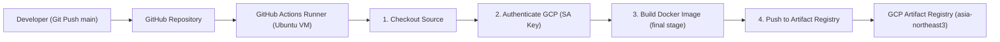
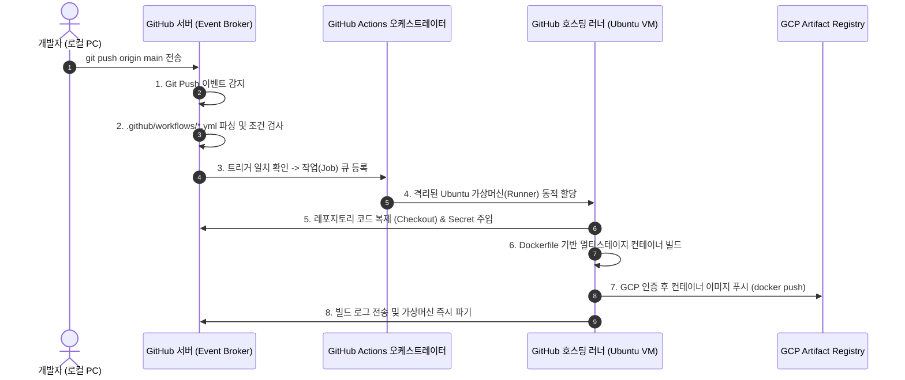

# GitHub Actions를 통한 GCP Artifact Registry 자동 빌드 및 배포 가이드

본 문서는 프로젝트 소스 코드를 컨테이너화하여 Google Cloud Platform(GCP) **Artifact Registry**에 자동으로 빌드 및 Push하는 CI/CD 파이프라인 구축 절차와 GitHub Actions의 내부 동작 원리를 안내합니다.

---

## 1. 배포 대상 환경 정보

| 항목 | 값 | 설명 |
| :--- | :--- | :--- |
| **GCP Region** | `asia-northeast3` | 서울 리전 |
| **GCP Project ID** | `ssu-agent-vertex-509708` | 대상 GCP 프로젝트 |
| **Artifact Registry 저장소** | `suntaechung-repo` | Docker 레지스트리 저장소 |
| **이미지 명** | `todo-backend` | 생성될 컨테이너 이미지 이름 |
| **태그** | `prod` | 배포 태그 |
| **최종 이미지 URI** | `asia-northeast3-docker.pkg.dev/ssu-agent-vertex-509708/suntaechung-repo/todo-backend:prod` | `compose-prod.yaml` 참조 이미지 |

---

## 2. 전체 파이프라인 아키텍처



---

## 3. GitHub Actions 동작 원리 (`git push` 시 일어나는 일)

개발자가 로컬 터미널에서 `git push origin main`을 실행했을 때, GitHub 플랫폼 내부에서는 다음과 같은 순서로 컨테이너 이미지 빌드와 배포가 진행됩니다.



### 1) Git Push 이벤트 감지 (Webhook & Event Bus)
- 로컬에서 푸시된 커밋 데이터가 GitHub 원격 저장소에 수신되면, GitHub 내부의 **이벤트 브로커(Event Broker)**가 `push` 이벤트를 발생시킵니다.
- 이벤트 객체에는 대상 브랜치(`main`), 커밋 해시, 변경된 파일 목록 등의 메타데이터가 담겨 있습니다.
- GitHub 시스템은 프로젝트의 `.github/workflows/` 디렉토리에 있는 YAML 파일들을 스캔하여 `on.push.branches` 조건에 `main`이 포함되어 있는지 확인합니다.

### 2) 클라우드 가상머신(Runner) 동적 프로비저닝
- 조건이 매칭되면 워크플로우에 정의된 `runs-on: ubuntu-latest`를 확인하고, 클라우드(Azure/AWS) 상에 대기 중인 가상머신 풀(Pool)에서 **독립된 Ubuntu 러너 VM**을 1~2초 만에 배정합니다.
- 이 VM에는 Linux 커널뿐만 아니라 **Docker Engine, Python, Node.js, Git, gcloud CLI**가 사전 설치(Pre-installed)되어 있습니다.

### 3) 단계별(Step-by-step) 컨테이너 빌드 및 전송
할당된 러너는 `deploy.yml`의 `steps`에 나열된 작업을 순차 실행합니다:
1. **`actions/checkout@v4`**: 방금 푸시된 최신 소스코드(`Dockerfile`, `backend/`, `client/` 등)를 러너 로컬 작업 디렉토리로 복제합니다.
2. **`google-github-actions/auth@v2`**: 저장소 Secrets에 저장된 `GCP_SA_KEY`를 메모리에 안전하게 로드하여 GCP 일회용 액세스 토큰을 발급받습니다.
3. **`gcloud auth configure-docker`**: 러너의 Docker 데몬에 `asia-northeast3-docker.pkg.dev` 주소에 대한 푸시 인증 권한을 구성합니다.
4. **`docker build ...` (컨테이너 생성)**:
   - 러너의 Docker 데몬이 루트의 `Dockerfile`을 읽어 멀티스테이지 빌드를 진행합니다:
     - Stage 1 (`client-build`): Node.js 환경에서 React 프론트엔드 정적 번들 빌드 (`npm run build`)
     - Stage 2 (`test`): Python 환경에서 백엔드 단위 테스트(`pytest`) 실행
     - Stage 3 (`final`): 테스트가 통과된 백엔드에 빌드된 React 산출물을 통합 패키징
   - 최종 결과물에 `asia-northeast3-docker.pkg.dev/ssu-agent-vertex-509708/suntaechung-repo/todo-backend:prod` 태그를 부착합니다.
5. **`docker push ...` (GCP 적재)**: 생성된 이미지를 네트워크를 통해 GCP 서울 리전의 **Artifact Registry**로 전송합니다.

### 4) 사후 처리 및 보안 격리
- 작업 완료 후 빌드 로그 및 성공/실패 상태가 GitHub 웹페이지(**Actions** 탭)에 실시간으로 기록됩니다.
- 작업이 종료되는 즉시 사용된 **가상머신은 영구 파기(Destroy)**되며, 메모리에 있던 소스코드와 비밀키 등 모든 데이터는 완전히 삭제됩니다.

---

## 4. 구축 단계별 절차

### 1단계: GCP 사전 설정 (서비스 계정 & 권한 부여)

GCP Cloud Shell 또는 로컬 터미널(`gcloud` CLI)에서 GitHub Actions 전용 서비스 계정을 생성하고 권한을 부여합니다.

```bash
# 1. 환경 변수 설정
export PROJECT_ID="ssu-agent-vertex-509708"
export SA_NAME="github-actions-sa"

# 2. 서비스 계정 생성
gcloud iam service-accounts create $SA_NAME \
    --project=$PROJECT_ID \
    --description="Service Account for GitHub Actions CI/CD" \
    --display-name="GitHub Actions SA"

# 3. Artifact Registry 작성자(Writer) 권한 부여
gcloud projects add-iam-policy-binding $PROJECT_ID \
    --member="serviceAccount:${SA_NAME}@${PROJECT_ID}.iam.gserviceaccount.com" \
    --role="roles/artifactregistry.writer"

# 4. JSON 서비스 계정 키 파일 생성 (key.json)
gcloud iam service-accounts keys create key.json \
    --iam-account="${SA_NAME}@${PROJECT_ID}.iam.gserviceaccount.com"
```

> **주의:** 발급받은 `key.json` 파일은 비공개 키이므로 절대 Git 저장소에 커밋하거나 외부에 노출하지 마십시오.

---

### 2단계: GitHub Repository Secret 등록

GitHub Actions가 GCP에 안전하게 인증할 수 있도록 키를 GitHub Secret으로 등록합니다.

1. 대상 GitHub 저장소(`speckit-fastapi-claude`)로 이동합니다.
2. **Settings** → 좌측 메뉴 **Secrets and variables** → **Actions** 선택
3. **New repository secret** 버튼 클릭:
   - **Name**: `GCP_SA_KEY`
   - **Secret**: 1단계에서 발급받은 `key.json` 파일 내용 전체 복사/붙여넣기
4. **Add secret** 버튼을 눌러 저장합니다.

---

### 3단계: GitHub Actions 워크플로우 확인

프로젝트 내 `.github/workflows/deploy.yml` 파일 내용 및 상세 주석:

```yaml
# ==============================================================================
# 워크플로우 이름: GitHub 웹 UI의 'Actions' 탭에 표시되는 이름입니다.
# ==============================================================================
name: Build and Push Docker Image to GCP Artifact Registry

# ==============================================================================
# 트리거(Trigger) 설정: 언제 이 자동화 파이프라인을 실행할지 정의합니다.
# ==============================================================================
on:
  # 1) Git Push 이벤트 발생 시
  push:
    branches:
      - main                  # main 브랜치에 코드가 push되었을 때만 실행 (기타 브랜치 무시)
    paths:
      # 아래에 지정된 코드/빌드 관련 경로의 파일이 변경되었을 때만 실행합니다.
      # (README.md, 문서, 기획서 등만 수정한 경우에는 불필요한 빌드를 방지하여 실행되지 않음)
      - 'backend/**'           # 백엔드 Python 코드, 테스트, requirements.txt 등
      - 'client/**'            # 프론트엔드 React/Vite 소스코드, package.json 등
      - 'Dockerfile'           # Docker 이미지 빌드 명세서
      - '.dockerignore'        # Docker 빌드 제외 목록 설정
      - 'pyproject.toml'       # 루트 프로젝트 패키지 설정
      - 'uv.lock'              # 파이썬 패키지 버전 잠금 파일
      - 'compose-prod.yaml'    # 프로덕션 Docker Compose 파일
      - '.github/workflows/deploy.yml' # 워크플로우 파일 자체 변경 시 테스트용

  # 2) 수동 실행(Manual Trigger) 활성화
  # GitHub 웹페이지 Actions 탭에서 개발자가 'Run workflow' 버튼을 눌러 원할 때 수동 실행 가능
  workflow_dispatch:

# ==============================================================================
# 환경 변수(Environment Variables) 설정: 워크플로우 전체에서 재사용할 상수값들입니다.
# ==============================================================================
env:
  GAR_LOCATION: asia-northeast3        # GCP 리전 (서울: asia-northeast3)
  PROJECT_ID: ssu-agent-vertex-509708  # GCP 프로젝트 ID
  REPOSITORY: suntaechung-repo         # GCP Artifact Registry 저장소(Repository) 이름
  IMAGE: todo-backend                  # 생성할 컨테이너 이미지 이름
  TAG: prod                            # 이미지 태그 (운영 배포용: prod)

# ==============================================================================
# 작업(Jobs) 정의: 러너(가상머신)에서 실행될 실제 단계별 작업 목록입니다.
# ==============================================================================
jobs:
  build-and-push:
    # GitHub이 제공하는 최신 Ubuntu 리눅스 가상머신(Runner)에서 실행합니다.
    runs-on: ubuntu-latest

    steps:
      # ------------------------------------------------------------------------
      # [Step 1] 소스코드 체크아웃
      # 가상머신 로컬 환경으로 push된 최신 Git 저장소 코드를 clone(복제)해 옵니다.
      # ------------------------------------------------------------------------
      - name: Checkout repository
        uses: actions/checkout@v4

      # ------------------------------------------------------------------------
      # [Step 2] Google Cloud 서비스 계정(IAM) 인증
      # GitHub 저장소의 Settings -> Secrets에 등록된 'GCP_SA_KEY'(JSON 비밀키)를
      # 사용하여 Google Cloud에 안전하게 인증하고 세션 토큰을 발급받습니다.
      # ------------------------------------------------------------------------
      - name: Authenticate to Google Cloud
        uses: google-github-actions/auth@v2
        with:
          credentials_json: ${{ secrets.GCP_SA_KEY }}

      # ------------------------------------------------------------------------
      # [Step 3] gcloud CLI 설정 및 Docker 인증 구성
      # Google Cloud SDK를 설정하고, 러너의 Docker 데몬이 GCP Artifact Registry
      # (asia-northeast3-docker.pkg.dev)로 이미지를 push할 수 있도록 인증 정보를 연결합니다.
      # ------------------------------------------------------------------------
      - name: Set up Cloud SDK and Configure Docker
        uses: google-github-actions/setup-gcloud@v2

      - name: Configure Docker for Artifact Registry
        run: |
          # 도커 데몬의 config.json에 Artifact Registry 호스트용 인증 헬퍼를 자동 등록 (--quiet: 무인 승인)
          gcloud auth configure-docker ${{ env.GAR_LOCATION }}-docker.pkg.dev --quiet

      # ------------------------------------------------------------------------
      # [Step 4] Docker Buildx 엔진 설정
      # 멀티스테이지 빌드, 향상된 캐싱 기능 및 빌드 최적화를 제공하는 Buildx를 활성화합니다.
      # ------------------------------------------------------------------------
      - name: Set up Docker Buildx
        uses: docker/setup-buildx-action@v3

      # ------------------------------------------------------------------------
      # [Step 5] Docker 이미지 빌드 및 Artifact Registry로 Push
      # 멀티스테이지 Dockerfile을 빌드하여 React 프론트와 FastAPI 백엔드가 번들링된
      # 최종 이미지를 생성한 뒤 GCP Artifact Registry로 전송합니다.
      # ------------------------------------------------------------------------
      - name: Build and Push Docker Image
        run: |
          # 1. 최종 이미지 주소(URI) 조합
          # 결과: asia-northeast3-docker.pkg.dev/ssu-agent-vertex-509708/suntaechung-repo/todo-backend:prod
          IMAGE_URI="${{ env.GAR_LOCATION }}-docker.pkg.dev/${{ env.PROJECT_ID }}/${{ env.REPOSITORY }}/${{ env.IMAGE }}:${{ env.TAG }}"
          
          echo "Building and Pushing image to: $IMAGE_URI"
          
          # 2. Docker 빌드 실행
          # --target final : Dockerfile의 여러 단계 중 최종 프로덕션 단계(final)를 타겟으로 지정
          #                  (내부적으로 client-build 스테이지와 pytest 테스트 스테이지가 자동 선행 실행됨)
          # -t $IMAGE_URI  : 빌드된 이미지에 GCP 레지스트리 주소와 태그를 부여
          # -f Dockerfile . : 현재 디렉토리(.)의 Dockerfile을 빌드 컨텍스트로 사용
          docker build \
            --target final \
            -t $IMAGE_URI \
            -f Dockerfile .
          
          # 3. GCP Artifact Registry 저장소로 이미지 푸시
          docker push $IMAGE_URI
```

---

### 4단계: 워크플로우 커밋 & 배포 확인

1. **파일 추가 및 푸시**:
   ```powershell
   git add .github/workflows/deploy.yml GitHubActions.md
   git commit -m "ci: add GitHub Actions workflow and deployment guide"
   git push origin main
   ```

2. **빌드 로그 확인**:
   - GitHub 저장소 상단 **Actions** 탭으로 이동합니다.
   - 실행 중인 `Build and Push Docker Image to GCP Artifact Registry` 워크플로우를 클릭하여 빌드 및 푸시 로그를 실시간으로 확인합니다.

3. **GCP 콘솔에서 확인**:
   - Google Cloud Console → **Artifact Registry** → **저장소** 이동
   - `suntaechung-repo` 진입 후 `todo-backend` 이미지의 `prod` 태그가 등록되었는지 확인합니다.

---

## 5. 트러블슈팅 가이드

- **`denied: Permission "artifactregistry.repositories.uploadArtifacts" denied` 에러**:
  - 서비스 계정에 `roles/artifactregistry.writer` 역할이 올바른 프로젝트/저장소에 부여되었는지 확인합니다.
- **`GCP_SA_KEY` 인식 오류**:
  - GitHub Secret 이름에 공백이나 오타가 없는지, JSON 내용 전체(중괄호 포함)가 누락 없이 붙여넣어졌는지 확인합니다.
- **Docker 빌드 실패 (pytest 실패 등)**:
  - Dockerfile은 멀티스테이지 구조로 `test` 스테이지에서 `pytest`를 수행합니다. 로컬에서 테스트가 통과하는지 먼저 확인하세요.
