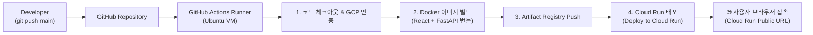
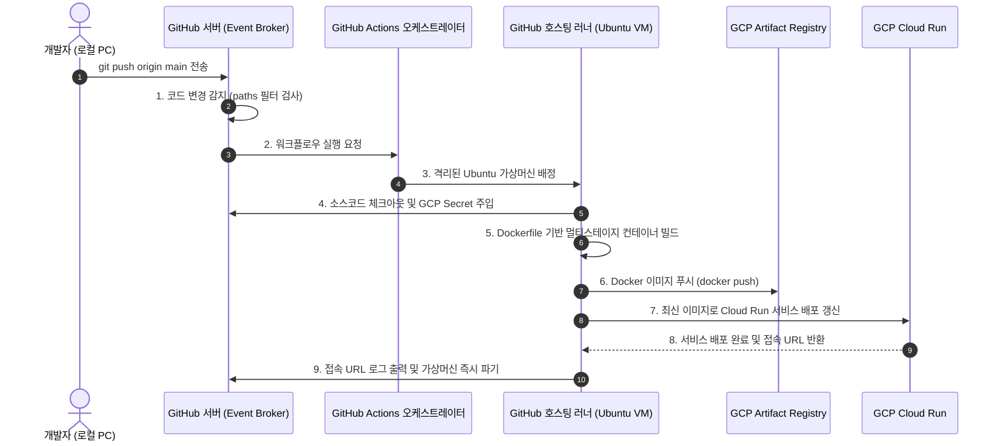

# GitHub Actions를 통한 GCP Artifact Registry 빌드 및 Cloud Run 자동 배포 가이드

본 문서는 프로젝트 소스 코드가 GitHub에 `push`되었을 때, 이를 자동으로 컨테이너화하여 Google Cloud Platform(GCP) **Artifact Registry**에 적재하고, 최종적으로 **Cloud Run**에 무중단 서버리스 컨테이너로 배포 및 실행되도록 하는 CI/CD 파이프라인 가이드입니다.

---

## 1. 배포 대상 환경 정보

| 항목 | 값 | 설명 |
| :--- | :--- | :--- |
| **GCP Region** | `asia-northeast3` | 서울 리전 |
| **GCP Project ID** | `ssu-agent-vertex-509708` | 대상 GCP 프로젝트 |
| **Artifact Registry 저장소** | `suntaechung-repo` | Docker 레지스트리 저장소 |
| **이미지 명** | `todo-backend` | 생성될 컨테이너 이미지 이름 |
| **태그** | `prod` | 배포 태그 |
| **최종 이미지 URI** | `asia-northeast3-docker.pkg.dev/ssu-agent-vertex-509708/suntaechung-repo/todo-backend:prod` | 빌드 및 배포 대상 이미지 |
| **Cloud Run 서비스 명** | `todo-backend` | Cloud Run에 생성/배포될 서비스 이름 |
| **컨테이너 포트** | `3000` | FastAPI 컨테이너 포트 |

---

## 2. 전체 CI/CD 파이프라인 아키텍처



---

## 3. GitHub Actions 동작 원리 (`git push` 시 일어나는 일)

개발자가 로컬 터미널에서 `git push origin main`을 실행하면, 다음과 같은 순서로 빌드와 배포가 일어납니다:



---

## 4. 구축 단계별 절차

### 1단계: GCP 사전 설정 (API 활성화, 서비스 계정 & 권한 부여)

Artifact Registry에 이미지를 올리고, Cloud Run에 컨테이너를 배포하기 위해 필요한 GCP API를 켜고 서비스 계정에 역할(Role)을 부여합니다.

```bash
# 1. 환경 변수 설정
export PROJECT_ID="ssu-agent-vertex-509708"
export SA_NAME="github-actions-sa"

# 2. 필수 GCP API 활성화 (Cloud Run 및 Artifact Registry)
# * API가 비활성화되어 있으면 권한이 있어도 PERMISSION_DENIED 에러가 발생합니다.
gcloud services enable run.googleapis.com artifactregistry.googleapis.com --project=$PROJECT_ID

# 3. 서비스 계정 생성 (이미 생성한 경우 생략 가능)
gcloud iam service-accounts create $SA_NAME \
    --project=$PROJECT_ID \
    --description="Service Account for GitHub Actions CI/CD" \
    --display-name="GitHub Actions SA"

# 4. Artifact Registry 작성자(Writer) 권한 부여
gcloud projects add-iam-policy-binding $PROJECT_ID \
    --member="serviceAccount:${SA_NAME}@${PROJECT_ID}.iam.gserviceaccount.com" \
    --role="roles/artifactregistry.writer"

# 5. Cloud Run 관리자 권한 부여 (Cloud Run 서비스 생성, 조회, 배포용)
gcloud projects add-iam-policy-binding $PROJECT_ID \
    --member="serviceAccount:${SA_NAME}@${PROJECT_ID}.iam.gserviceaccount.com" \
    --role="roles/run.admin"

# 6. 서비스 계정 사용자(Service Account User) 권한 부여 (Cloud Run 실행 계정 위임용)
gcloud projects add-iam-policy-binding $PROJECT_ID \
    --member="serviceAccount:${SA_NAME}@${PROJECT_ID}.iam.gserviceaccount.com" \
    --role="roles/iam.serviceAccountUser"

# 7. JSON 서비스 계정 키 파일 생성 (key.json) - 아직 발급받지 않은 경우에만 실행
gcloud iam service-accounts keys create key.json \
    --iam-account="${SA_NAME}@${PROJECT_ID}.iam.gserviceaccount.com"
```

> **보안 주의:** 발급받은 `key.json` 파일은 비공개 키이므로 절대 Git에 커밋하지 마십시오. (본 프로젝트의 `.gitignore`에 이미 제외 등록되어 있습니다.)

---

### 2단계: GitHub Repository Secret 등록

1. 대상 GitHub 저장소(`speckit-fastapi-claude`)로 이동합니다.
2. **Settings** → **Secrets and variables** → **Actions** 선택
3. **New repository secret** 버튼 클릭:
   - **Name**: `GCP_SA_KEY`
   - **Secret**: `key.json` 파일의 내용 전체(중괄호 `{...}` 포함) 붙여넣기
4. **Add secret** 버튼을 눌러 저장합니다.

---

### 3단계: GitHub Actions 워크플로우 구성

프로젝트 내 [.github/workflows/deploy.yml](file:///d:/Lecture%20Notes/2026-2CloudComputing/practices/9week(Agent)/speckit-fastapi-claude/.github/workflows/deploy.yml) 파일 내용:

```yaml
# ==============================================================================
# 워크플로우 이름: GitHub 웹 UI의 'Actions' 탭에 표시되는 이름입니다.
# ==============================================================================
name: Build, Push to GAR, and Deploy to Cloud Run

# ==============================================================================
# 트리거(Trigger) 설정: 언제 이 자동화 파이프라인을 실행할지 정의합니다.
# ==============================================================================
on:
  # 1) Git Push 이벤트 발생 시
  push:
    branches:
      - main                  # main 브랜치에 코드가 push되었을 때만 실행
    paths:
      # 아래에 지정된 코드/빌드 관련 경로의 파일이 변경되었을 때만 실행합니다.
      # (README.md, 문서 등만 수정한 경우에는 불필요한 빌드를 방지하여 실행되지 않음)
      - 'backend/**'           # 백엔드 Python 코드, 테스트, requirements.txt 등
      - 'client/**'            # 프론트엔드 React/Vite 소스코드, package.json 등
      - 'Dockerfile'           # Docker 이미지 빌드 명세서
      - '.dockerignore'        # Docker 빌드 제외 목록 설정
      - 'pyproject.toml'       # 루트 프로젝트 패키지 설정
      - 'uv.lock'              # 파이썬 패키지 버전 잠금 파일
      - 'compose-prod.yaml'    # 프로덕션 Docker Compose 파일
      - '.github/workflows/deploy.yml' # 워크플로우 파일 자체 변경 시 테스트용

  # 2) 수동 실행(Manual Trigger) 활성화
  workflow_dispatch:

# ==============================================================================
# 환경 변수(Environment Variables) 설정: 워크플로우 전체에서 재사용할 상수값들입니다.
# ==============================================================================
env:
  GAR_LOCATION: asia-northeast3        # GCP 리전 (서울: asia-northeast3)
  PROJECT_ID: ssu-agent-vertex-509708  # GCP 프로젝트 ID
  REPOSITORY: suntaechung-repo         # GCP Artifact Registry 저장소(Repository) 이름
  IMAGE: todo-backend                  # 생성할 컨테이너 이미지 이름
  TAG: prod                            # 이미지 태그 (운영 배포용: prod)
  SERVICE_NAME: todo-backend           # Cloud Run 서비스 이름

# ==============================================================================
# 작업(Jobs) 정의: 러너(가상머신)에서 실행될 실제 단계별 작업 목록입니다.
# ==============================================================================
jobs:
  build-and-deploy:
    # GitHub이 제공하는 최신 Ubuntu 리눅스 가상머신(Runner)에서 실행합니다.
    runs-on: ubuntu-latest

    steps:
      # ------------------------------------------------------------------------
      # [Step 1] 소스코드 체크아웃
      # 가상머신 로컬 환경으로 push된 최신 Git 저장소 코드를 clone(복제)해 옵니다.
      # ------------------------------------------------------------------------
      - name: Checkout repository
        uses: actions/checkout@v4

      # ------------------------------------------------------------------------
      # [Step 2] Google Cloud 서비스 계정(IAM) 인증
      # GitHub 저장소의 Settings -> Secrets에 등록된 'GCP_SA_KEY'(JSON 비밀키)를
      # 사용하여 Google Cloud에 안전하게 인증하고 세션 토큰을 발급받습니다.
      # ------------------------------------------------------------------------
      - name: Authenticate to Google Cloud
        uses: google-github-actions/auth@v2
        with:
          credentials_json: ${{ secrets.GCP_SA_KEY }}

      # ------------------------------------------------------------------------
      # [Step 3] gcloud CLI 설정 및 Docker 인증 구성
      # Google Cloud SDK를 설정하고, 러너의 Docker 데몬이 GCP Artifact Registry
      # (asia-northeast3-docker.pkg.dev)로 이미지를 push할 수 있도록 인증 정보를 연결합니다.
      # ------------------------------------------------------------------------
      - name: Set up Cloud SDK and Configure Docker
        uses: google-github-actions/setup-gcloud@v2

      - name: Configure Docker for Artifact Registry
        run: |
          # 도커 데몬의 config.json에 Artifact Registry 호스트용 인증 헬퍼를 자동 등록 (--quiet: 무인 승인)
          gcloud auth configure-docker ${{ env.GAR_LOCATION }}-docker.pkg.dev --quiet

      # ------------------------------------------------------------------------
      # [Step 4] Docker Buildx 엔진 설정
      # 멀티스테이지 빌드, 향상된 캐싱 기능 및 빌드 최적화를 제공하는 Buildx를 활성화합니다.
      # ------------------------------------------------------------------------
      - name: Set up Docker Buildx
        uses: docker/setup-buildx-action@v3

      # ------------------------------------------------------------------------
      # [Step 5] Docker 이미지 빌드 및 Artifact Registry로 Push
      # 멀티스테이지 Dockerfile을 빌드하여 React 프론트와 FastAPI 백엔드가 번들링된
      # 최종 이미지를 생성한 뒤 GCP Artifact Registry로 전송합니다.
      # ------------------------------------------------------------------------
      - name: Build and Push Docker Image
        run: |
          IMAGE_URI="${{ env.GAR_LOCATION }}-docker.pkg.dev/${{ env.PROJECT_ID }}/${{ env.REPOSITORY }}/${{ env.IMAGE }}:${{ env.TAG }}"
          
          echo "Building and Pushing image to: $IMAGE_URI"
          
          # Dockerfile의 final 스테이지 빌드 (client-build 및 pytest 선행 수행)
          docker build \
            --target final \
            -t $IMAGE_URI \
            -f Dockerfile .
          
          # Artifact Registry로 이미지 푸시
          docker push $IMAGE_URI

      # ------------------------------------------------------------------------
      # [Step 6] GCP Cloud Run 서비스로 컨테이너 배포
      # 방금 푸시한 이미지를 가져와 Cloud Run에 서버리스 컨테이너 서비스로 배포합니다.
      # ------------------------------------------------------------------------
      - name: Deploy to Cloud Run
        id: deploy
        uses: google-github-actions/deploy-cloudrun@v2
        with:
          service: ${{ env.SERVICE_NAME }}
          region: ${{ env.GAR_LOCATION }}
          image: ${{ env.GAR_LOCATION }}-docker.pkg.dev/${{ env.PROJECT_ID }}/${{ env.REPOSITORY }}/${{ env.IMAGE }}:${{ env.TAG }}
          flags: |
            --port=3000
            --allow-unauthenticated

      # ------------------------------------------------------------------------
      # [Step 7] 배포된 Cloud Run 웹 URL 출력
      # 배포가 완료되면 접속 가능한 공용(Public) URL을 워크플로우 로그에 출력합니다.
      # ------------------------------------------------------------------------
      - name: Show Cloud Run Service URL
        run: |
          echo "=========================================================="
          echo "🚀 Cloud Run 배포 성공!"
          echo "🌐 서비스 접속 URL: ${{ steps.deploy.outputs.url }}"
          echo "=========================================================="
```

---

### 4단계: 워크플로우 커밋 & 배포 확인

1. **파일 추가 및 푸시**:
   ```powershell
   git add .github/workflows/deploy.yml GitHubActions.md .gitignore
   git commit -m "ci: add Cloud Run deployment step to GitHub Actions"
   git push origin main
   ```

2. **빌드 및 배포 로그 확인**:
   - GitHub 저장소 상단 **Actions** 탭으로 이동합니다.
   - 실행 중인 `Build, Push to GAR, and Deploy to Cloud Run` 워크플로우를 클릭합니다.
   - `Show Cloud Run Service URL` 단계가 완료되면 브라우저에서 바로 접속 가능한 서비스 URL(예: `https://todo-backend-xxxxxxxxxx-du.a.run.app`)이 출력됩니다.

3. **GCP 콘솔에서 확인**:
   - Google Cloud Console → **Cloud Run** 접속
   - `todo-backend` 서비스의 녹색 체크(정상 실행) 상태와 트래픽 배분, URL을 확인합니다.

---

## 5. 트러블슈팅 가이드

- **`PERMISSION_DENIED: Permission 'run.services.get' denied on resource 'namespaces/ssu-agent-vertex-509708/services/todo-backend'` 에러**:
  - **원인 1 (가장 흔함)**: GCP 프로젝트에서 Cloud Run API가 비활성화되어 있는 경우입니다.
    - **해결**: `gcloud services enable run.googleapis.com --project=ssu-agent-vertex-509708` 실행
  - **원인 2**: 서비스 계정에 Cloud Run 관리자 권한(`roles/run.admin`)이 아직 부여되지 않은 경우입니다.
    - **해결**: `gcloud projects add-iam-policy-binding ssu-agent-vertex-509708 --member="serviceAccount:github-actions-sa@ssu-agent-vertex-509708.iam.gserviceaccount.com" --role="roles/run.admin"` 실행
  - **원인 3**: 방금 권한을 부여했으나 GCP IAM 서버 간 동기화(권한 전파)에 1~2분이 걸리는 경우입니다.
    - **해결**: 1~2분 대기 후 GitHub 저장소 **Actions** 탭에서 실패한 워크플로우를 열고 **Re-run jobs** 버튼을 클릭하여 재시도합니다. (코드 다시 push 불필요)

- **`The user does not have permission to act as 'serviceAccount:...'` 에러**:
  - 서비스 계정에 `roles/iam.serviceAccountUser` 권한이 부여되었는지 확인합니다.
  - **해결**: `gcloud projects add-iam-policy-binding ssu-agent-vertex-509708 --member="serviceAccount:github-actions-sa@ssu-agent-vertex-509708.iam.gserviceaccount.com" --role="roles/iam.serviceAccountUser"` 실행

- **`denied: Permission "artifactregistry.repositories.uploadArtifacts" denied` 에러**:
  - 서비스 계정에 `roles/artifactregistry.writer` 역할이 올바른 프로젝트/저장소에 부여되었는지 확인합니다.

- **포트 응답 실패 에러 (Container failed to start)**:
  - Dockerfile의 FastAPI 실행 포트가 `3000`번이므로 워크플로우 `flags`에 `--port=3000`이 지정되어 있어야 합니다.
